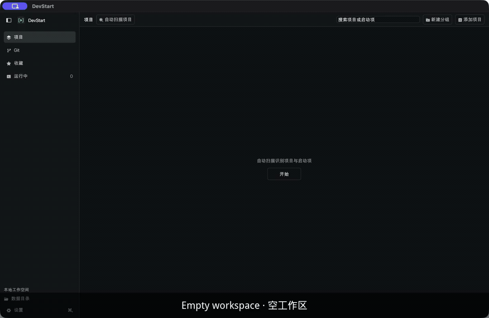
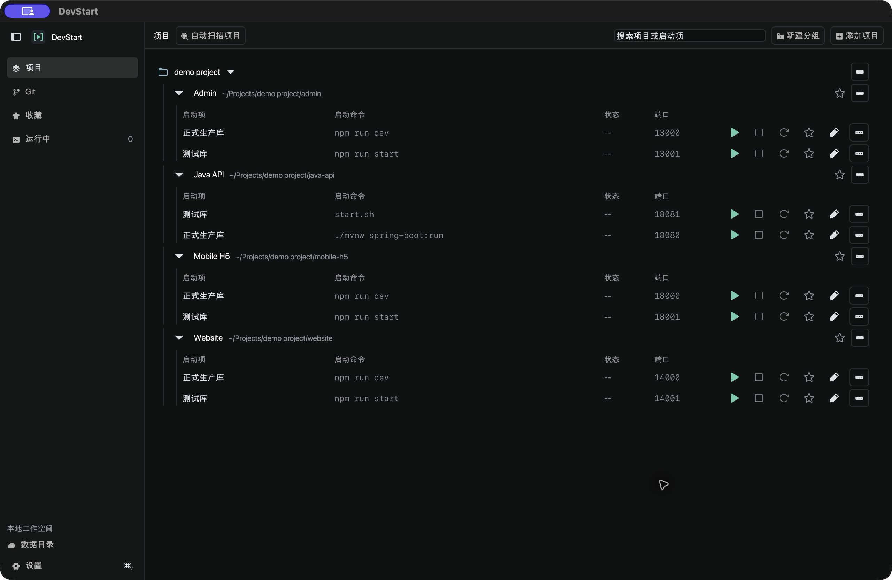
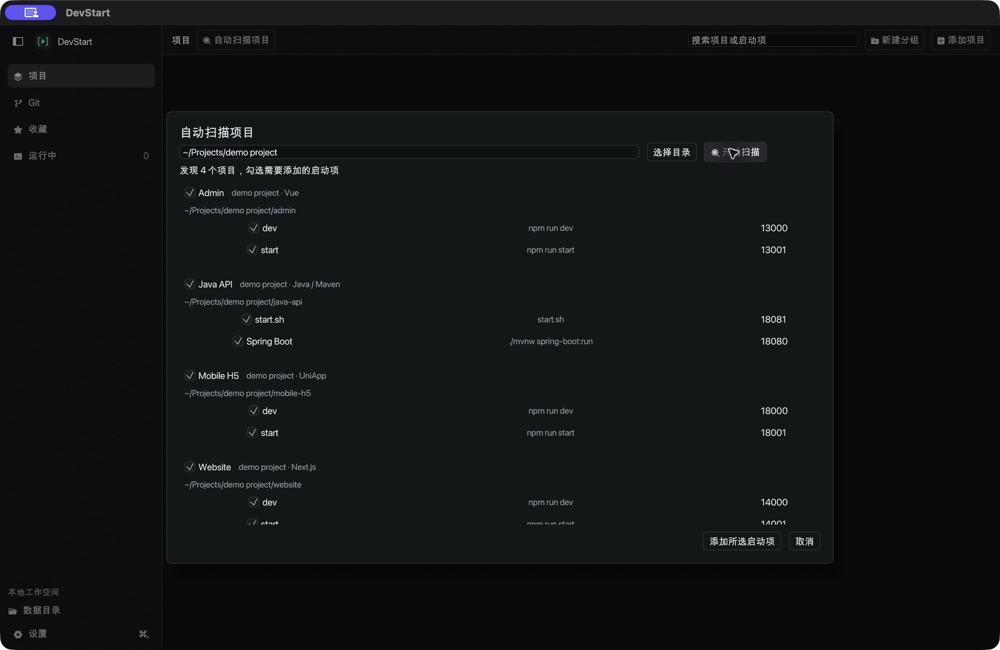
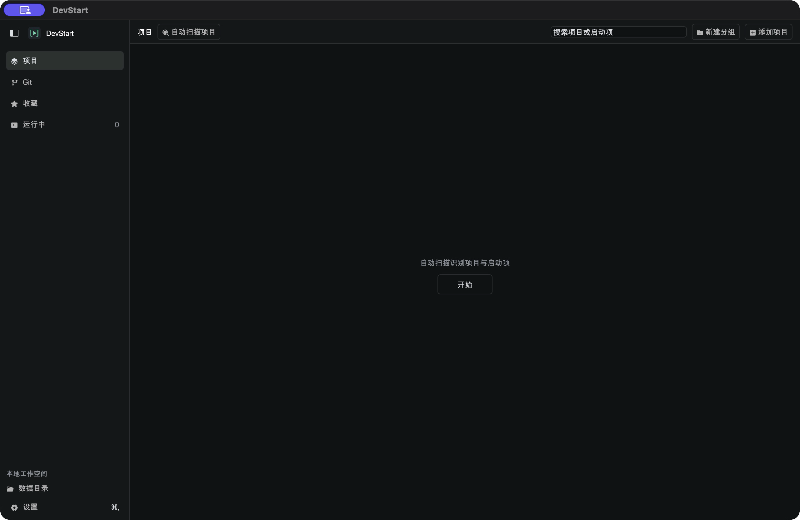
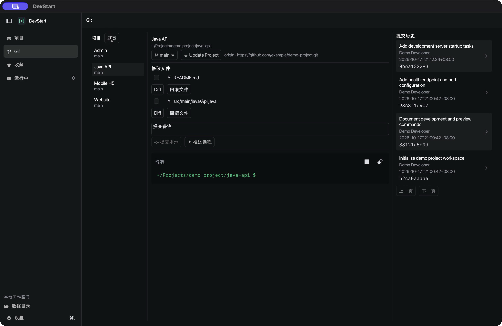
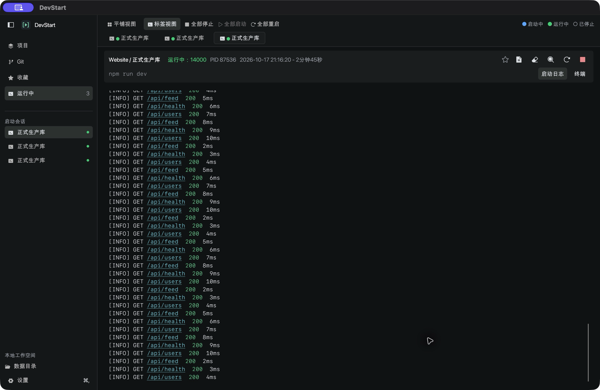
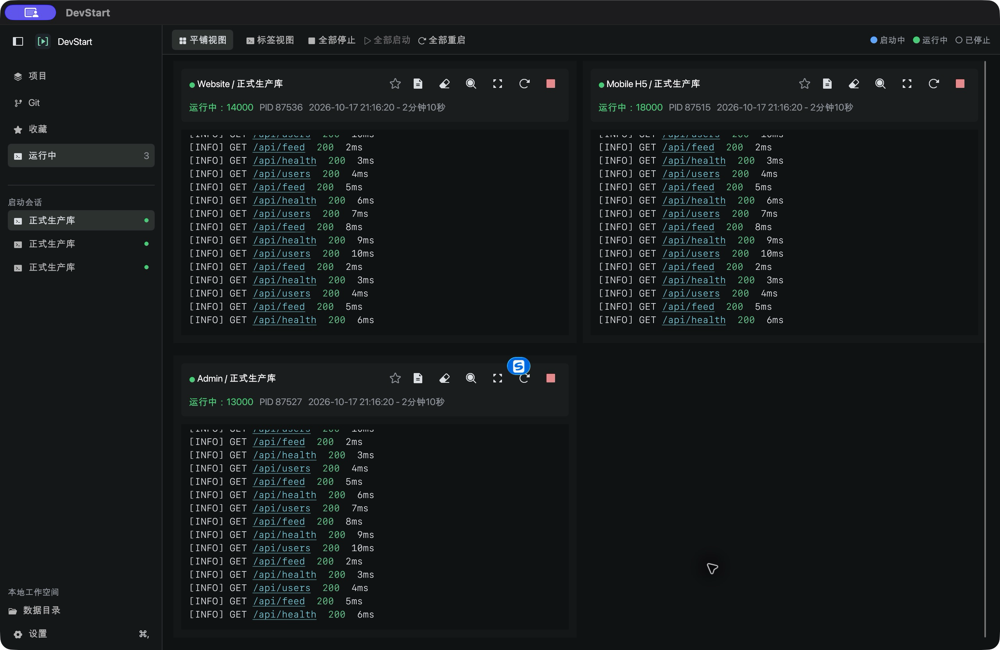

<p align="center"></p>

<h1 align="center">DevStart</h1>
<p align="center"><strong>项目多到管不过来？DevStart 一键启动、看日志、做 Git，AI 也能用。</strong></p>
<p align="center">适合 AI Coding 时代的多项目启动工作台。<br>A multi-project launch workbench for the AI Coding era.</p>
<p align="center">项目多也不乱。<br>More projects. Less friction.</p>

<p align="center">简体中文 · <a href="README_EN.md">English</a></p>

<p align="center"></p>

AI Coding 让一个人同时推进多个项目变得常见，启动、停止、看日志和来回切换却仍然占用注意力。DevStart 把这些高频操作集中到一个 Rust 原生桌面窗口：快速找到项目，点击启动，随时查看状态和日志，再切回手头的工作。

## 核心价值

- **多项目高频切换，操作尽量简单**：通过分组、搜索、收藏和运行中筛选找到项目，少翻目录、少找终端。
- **启停和日志集中可见**：为同一项目保留多个启动项，独立启动、停止和重启；通过标签或平铺 Console 查看多个项目的输出。
- **有依赖，也保持直接**：当前端需要本地 API 时，找到 API 项目、点击启动，再切回前端 Console。相关项目由你选择，按需要分别启动。

## 给 AI Coding Agent 用

DevStart 暴露本地 JSON-RPC API、CLI 以及 MCP 服务（stdio，`dev-start --mcp`）。Cursor、Claude Code、Codex 等 AI coding agent 可以直接列出项目、启停/重启启动项，并读取或搜索日志——不必离开对话窗口去翻终端。

先启动 GUI，或以 `cargo run --locked -- --serve` 启动同一工作空间的无界面服务，再在 MCP 客户端中配置（路径换成本机二进制）：

```json
{
  "mcpServers": {
    "dev-start": {
      "command": "/absolute/path/to/dev-start",
      "args": ["--mcp"]
    }
  }
}
```

也可直接调用 CLI：`cargo run --locked -- --api projects.list`。完整方法与约定见下方 [AI / API / MCP](#ai--api--mcp) 与 [API 文档](docs/api.md)。

## 适用场景

- 一个人在多个 AI Coding 项目、原型或日常维护项目间反复切换。
- 联调前端、API、后台等本地项目，需要临时启动相关服务，再回到当前项目继续开发。
- 多个项目同时运行，需要在一个窗口查看状态、端口和日志，或只重启其中一个启动项。

DevStart 聚焦日常启动与切换，不自动解析跨项目依赖，也不安排依赖启动顺序、就绪检查或复杂流程编排。

**脚本仍属于原项目。** DevStart 引用项目自己的文件、命令和参数，不接管项目依赖，不在导入时运行脚本。开源版初次启动没有项目、启动项或个人分组，只有一个空的默认分组。

## 下载 1.0

[正式发布与下载](https://github.com/dennislee666/DevStart/releases/latest)：macOS 12 及以上，Universal（Intel x86_64 / Apple Silicon）。安装及签名说明见[1.0 发布说明](docs/releases/1.0.md)。

## 界面预览

以下截图使用 **demo project 虚拟工作区**：Java API、Admin、Website、Mobile H5，每个项目有“正式生产库”和“测试库”两个演示启动项。



### 自动扫描项目

选择一个目录，后台识别项目、技术栈、已有启动脚本和可确定的端口；勾选需要的启动项，确认后自动创建分组与项目。支持 Vue、UniApp、Next.js、Node.js、Python、Java、PHP 等已有启动协议。扫描不运行项目代码，不向项目仓库写管理配置；未知端口显示 `--`。完整范围与限制见[自动扫描说明](docs/project-scan.md)。



<details><summary>空工作区状态</summary>



</details>

### Git 工作台

项目分支与远程选择、Update Project、修改文件清单、提交/推送、交互终端和提交历史集中展示。点击历史可查看文件增删行数，双击文件打开多标签 Diff。详见[Git 工作台](docs/git-workspace.md)。



### 启动日志与平铺





**演示说明：** 开源版首次启动会在本地工作区生成虚拟 `demo project` 分组，包含 Java API、Admin、Website、Mobile H5 四个项目及演示/测试入口。入口仅在用户点击启动后运行回环模拟服务，不访问生产/测试数据库、外网或部署环境。已有工作区不会被覆盖；删除演示分组后也不会自动重建。详见[截图与演示说明](docs/showcase.md)。

## 功能

- **自动扫描**：按目录批量识别项目与启动项，勾选后导入，自动分组及去重；支持扫描 API。

- **项目与启动项**：分组、收藏、搜索、“修改信息”统一编辑显示名和简介，同一项目多个运行参数；独立状态列与启动前配置端口展示。
- **进程管理**：同时启动多个项目；启动前核实旧实例，先优雅退出，超时再强制关闭；生命周期事件输出到 Console；当前标签内重启，批量启动/停止/重启均有二次确认。
- **Console**：标签切换与平铺、关键词搜索/过滤、跟随输出、磁盘日志限额与自动回收、独立窗口、ANSI 颜色、自动换行与链接打开；运行状态、端口、启动日期及累计时长。
- **源文件编辑**：Rust、Java、Python、Shell、前端等语法高亮，行号、自动换行，冲突检测、原子保存及每个启动项最近 10 个版本回退。
- **外观设置**：深色/浅色/系统主题，界面与 Console 字体、字号、行距、密度，可折叠侧栏。
- **AI 与自动化**：本地 JSON-RPC API、CLI、MCP，配置管理、启停、日志查询和编辑/回退均可调用。

- **基础 Git 工作区**：在已登记项目间切换，选择已有本地分支和远程地址，查看变更、提交、推送及拉取更新并合并；浏览提交历史、文件新增/删除行数和多标签 Diff。详见 [Git 工作区](docs/git-workspace.md)。
- **项目交互终端**：在项目目录使用持续 shell 会话，支持命令历史、实时彩色输出和 Ctrl+C；Git 页与运行页共享项目终端，运行页可切换启动日志与终端。

## 路线图

基础 Git 工作区已提供跨项目的日常仓库操作；用户身份与凭据沿用现有 Git 配置，选择远程地址不等于切换账户。计划增加**多账户身份与凭据管理**，具体范围与时间待定。后续改进继续围绕多项目高频切换，保持操作简单。

## 平台与依赖

当前正式验证平台是 **macOS 12 Monterey 及以上**；安装包默认同时包含 Intel `x86_64` 与 Apple Silicon `arm64`。使用 Rust / eframe / egui，无需为 DevStart 安装 Node.js 或 WebView。Linux 的图形与进程工具路径仍需适配验证；Windows 暂未实现进程组管理，不承诺可用。

- Rust **1.88+**，建议使用稳定版工具链。Universal 打包会通过 RsProxy 获取缺少的 macOS 架构标准库；应用的 Apple 最低系统版本为 macOS 12.0。
- macOS Command Line Tools；外部进程/端口识别使用系统 `ps` 和 `lsof`。
- 被启动项目仍需自行准备它的 JDK、Node.js、Python、Rust 等依赖。

## 快速开始

```bash
git clone --branch open-source https://github.com/dennislee666/DevStart.git
cd DevStart
cargo run --locked
```

添加一个本地项目，读取它已有的启动脚本；复杂入口通过本地 API 明确登记。所有启动定义保存在 DevStart 用户数据目录的 `projects/<项目 ID>/.dev-start.json`，不往业务仓库写入配置。导入和刷新不执行启动命令。

```json
{
  "version": 1,
  "launches": [
    {
      "name": "前端开发",
      "file": "package.json",
      "entry": { "Package": { "manager": "npm", "name": "dev" } },
      "description": "运行项目自身的 dev 命令",
      "expected_port": 5173
    }
  ]
}
```

原项目的 `package.json` 需实际提供 `scripts.dev`，端口需与实际项目一致。更多 File / Package / Command / Java 定义见[启动清单](docs/project-launch-manifest.md)。仓库中的示例不会自动导入。

## 日常使用

1. **添加并整理项目**：添加本地项目，按工作内容分组，把常用项目或启动项加入收藏。先确认扫描得到的入口；复杂入口通过本地 API 登记。
2. **找到并启动**：用搜索、收藏或运行中筛选定位项目，点击启动项的播放按钮启动，查看状态和 Console 输出。
3. **补上相关服务**：例如前端需要本地 API，就找到 API 项目并启动，再点击前端 Console 标签继续工作。相关项目及启动顺序由你选择。
4. **查看与调整**：在标签间切换或平铺查看日志；按需停止或重启某个启动项。批量启停与重启仅作用于当前已打开的 Console 标签，并需确认。

更多参数、端口、日志、编辑及快捷键说明见[使用说明](docs/usage.md)。

## macOS 打包

```bash
bash scripts/package-macos.sh
open dist/DevStart.app
```

本地命令生成 Universal 应用（可用 `DEVSTART_MACOS_ARCH=native` 仅构建本机架构），默认使用临时签名。正式 Actions 发布另需 Developer ID 签名、Apple 公证、票据装订和 Gatekeeper 验证，配置见 [macOS 签名与公证](docs/macos-signing.md)。仓库不包含预置的个人配置或已打包应用。

## AI / API / MCP

先启动 GUI，或以 `cargo run --locked -- --serve` 启动同一个工作空间的无界面服务，再由另一个终端调用：

```bash
cargo run --locked -- --api api.describe
cargo run --locked -- --api projects.list
```

MCP 客户端使用已编译的 `target/release/dev-start --mcp` 通过 stdio 连接本地服务。所有配置都由后端校验与持久化。完整方法、参数、日志分页与编辑器协议见 [API 文档](docs/api.md) 和 [Schema](docs/api-schema.json)。文档开头提供 AI 执行约定、任务调用顺序、ID 与状态说明及失败重试策略；客户端首次接入请先调用 `api.describe`，以当前二进制契约为准。

## 数据与隐私

开源版的默认数据目录是 `~/Library/Application Support/devstart`，与个人版的 `dev-start` 目录隔离；CLI、MCP 和 GUI 使用相同规则。可通过 `DEV_START_DATA_DIR` 显式指定另一个独立目录。

配置、日志、备份和编辑历史留在本机，不提交到仓库。源文件只在明确保存或回退时写入；备份目录为用户私有权限。第三方脚本的行为与权限由用户负责选择。首次导入前没有运行命令；带有构建、部署、上传等名称的自动扫描入口会被排除，显式定义的禁用入口保持禁用。

## 开发与验证

```bash
cargo fmt --check
cargo clippy --all-targets --locked -- -D warnings
cargo test --locked
cargo build --release --locked
python3 scripts/verify-api.py
# 可选：已安装 JDK 时验证 Java 源文件保存、编译失败隔离及回退
python3 scripts/verify-editor-java.py
```

验证脚本只使用临时目录和示例进程，不依赖个人项目。依赖锁定在 `Cargo.lock`；仓库默认走 crates.io（及 Cargo 官方 registry），保证 GitHub Actions 等环境不依赖国内镜像。更多来源说明见[依赖说明](docs/dependency-sources.md)。

**可选（国内网络）：** 若本机访问 crates.io 较慢，可在**用户级** `~/.cargo/config.toml`（勿提交到本仓库）启用 RsProxy 等镜像，例如：

```toml
[source.crates-io]
replace-with = "rsproxy-sparse"

[source.rsproxy-sparse]
registry = "sparse+https://rsproxy.cn/index/"
```

也可选用其他可用的 crates 镜像。项目内 `.cargo/config.toml` 刻意不强制镜像，以免 CI 因镜像 504 等失败。

## 文档与参与

- [项目介绍 / About](docs/about.md)
- [使用说明](docs/usage.md)
- [架构](docs/architecture.md)
- [项目启动清单](docs/project-launch-manifest.md)
- [API 与 AI 接入](docs/api.md)
- [贡献指南](docs/contributing.md)
- [安全与数据说明](docs/security.md)
- [开源/个人版本隔离](docs/release-channels.md)
- [依赖与第三方声明](docs/third-party-notices.md)

欢迎通过 Issues 和 Pull Requests 反馈问题或贡献代码。提交日志、截图和示例前，请移除本地路径、账号、令牌和业务数据。

## 许可证

项目代码使用 [MIT License](LICENSE)。第三方依赖、字体和图标保留其各自许可，见[第三方声明](docs/third-party-notices.md)。


### 界面语言

DevStart 支持简体中文和英文，默认跟随系统首选的受支持语言。可在设置 → 语言 → 界面语言中选择，然后应用并保存。切换语言不会重启服务，也不会翻译用户内容和原始日志。

非 Git AI 自动化覆盖分组、项目、启动项、扫描、启停、日志、编辑器、终端与设置。完整契约见 [API 与 MCP 说明书](docs/api.md#10-非-git-能力开放与独立-mcp-工具)；运行时可调用 api.docs 或读取 devstart://docs/api。
